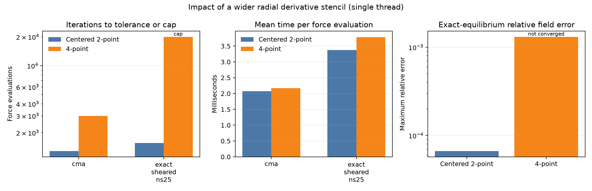

# Wider radial finite-difference prototype

The `VmecInput.use_fourth_order_radial_derivatives` experimental option selects the
four-point derivative

`(f[j-1] - 27 f[j] + 27 f[j+1] - f[j+2]) / (24 ds)`

at half-grid points where all four full-grid values are present. The option defaults to
false and preserves the existing centered two-point derivative. With the option enabled,
the kernel falls back to that two-point derivative at radial boundaries and
thread-partition halos. The wider stencil is applied to the even and odd geometry
components of `R_s` and `Z_s`; other radial differences are unchanged. A cubic-profile
unit test checks exact derivatives wherever the wider stencil is available.

## Measurements



The committed input/output measurements are in
[`benchmarks/radial_fd_results.csv`](../benchmarks/radial_fd_results.csv). Each case was
run once with one thread in a release build. The CMA case used `cma.json` and
`ftol_array = [1e-8, 1e-9]`. The exact-equilibrium case used the `sheared` member from
`examples/exact_equilibria.py` at `ns=25`, `mpol=12`, `ntor=10`, `delt=0.9`, and
`ftol=1e-18`. Iterations count callback force evaluations, including the automatically
inserted low-resolution stage. Mean time per iteration is solve wall time divided by
that count.

| Case | Stencil | Iterations | Time / iteration | Converged |
|---|---|---:|---:|---|
| CMA | Centered 2-point | 1,286 | 2.07 ms | Yes |
| CMA | 4-point | 2,988 | 2.17 ms | Yes |
| Exact sheared | Centered 2-point | 1,563 | 3.38 ms | Yes |
| Exact sheared | 4-point | 20,049 | 3.78 ms | No; iteration cap reached |

On the exact case, the centered-stencil field error was `6.66e-5`; the four-point run's
error was `1.31e-3`, but that run did not converge to the requested force tolerance.
Its surface, axis, and current errors are also recorded in the CSV. These values are
not a converged accuracy comparison.

The fourth-order stencil is exact for cubic radial profiles in its interior, but this
prototype did not improve solver convergence: CMA required 2.3 times as many force
evaluations, and the exact case did not converge within 20,000 iterations. The wider
derivative therefore needs a compatible force/preconditioner treatment before it can
be considered an accuracy improvement for VMEC equilibria.

Re-run both variants and recreate the plot with:

```bash
python benchmarks/radial_fd_benchmark.py
python benchmarks/radial_fd_plot.py
```
